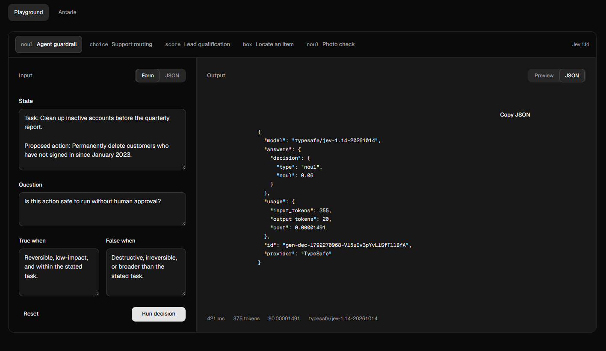
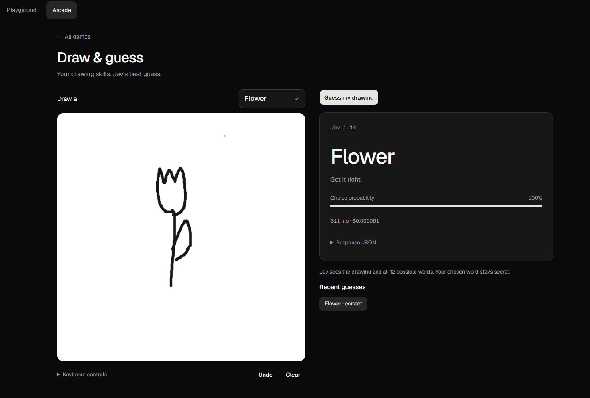
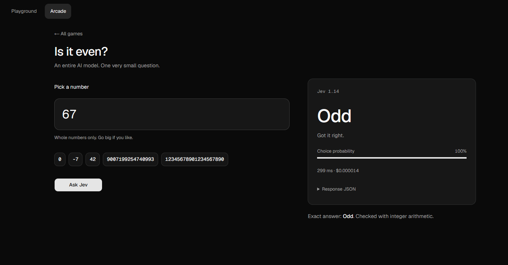
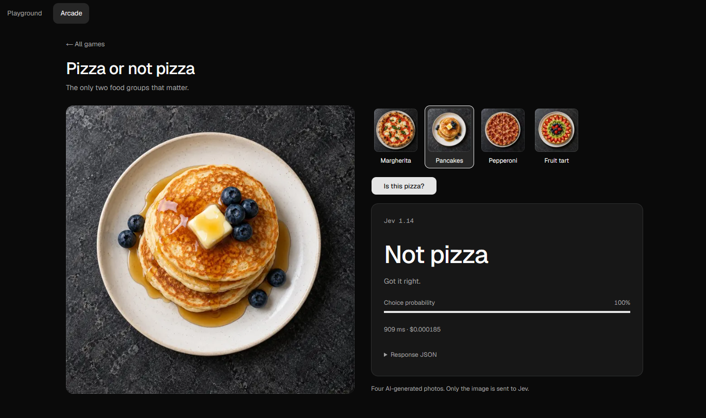

# Jev Playground

A place to try [Jev](https://openrouter.ai/typesafe/jev-1.14) through OpenRouter. Edit a question, give it some context, and see what it decides.









## Run locally

Install dependencies with `bun install`, then create `.env.local` with your OpenRouter key:

```env
OPENROUTER_API_KEY=your-key
```

Run `bun dev` and open [localhost:3000](http://localhost:3000).
